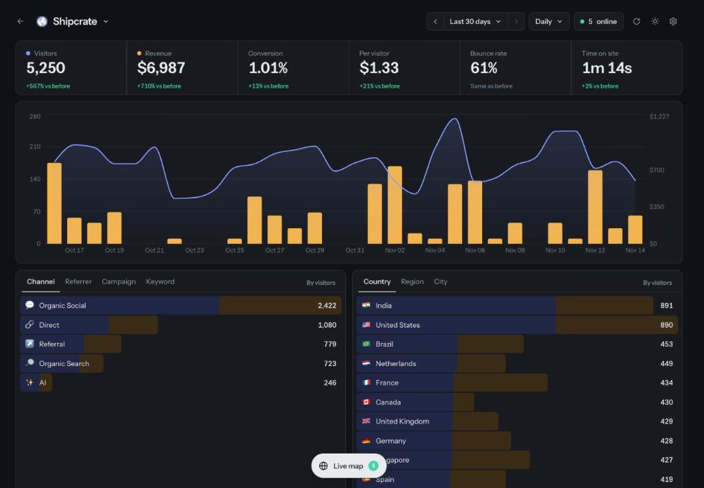
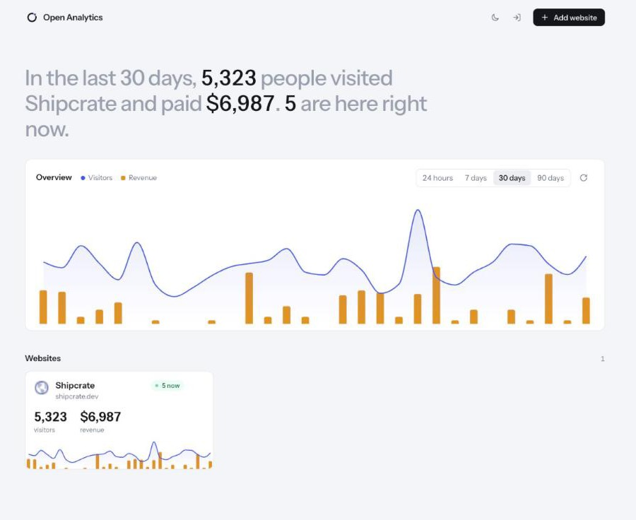

# Open Analytics: a free, open-source DataFast alternative

**Free, self-hosted web analytics with revenue attribution.** See where your visitors come from and which source made
you money: the tweet, the Reddit thread, the Google search or the ChatGPT answer. Open Analytics runs on Cloudflare's
free plan, keeps your data in your own Cloudflare account, and is open source under the MIT license.

It's an open-source alternative to [DataFast](https://datafa.st), and a lightweight, privacy-friendly alternative to
Google Analytics, built for indie hackers, SaaS founders and makers who want to know what actually brings in sales.

[](LICENSE)
[](https://workers.cloudflare.com)
[](tsconfig.json)



## Features

- **Revenue attribution:** every payment is tied to the visitor who paid and the source, campaign or post that brought
  them. Works with Stripe, Dodo Payments, or any provider through a simple API
- **Visitors and revenue together:** visitors, revenue, conversion rate, revenue per visitor, bounce rate and time on
  site, each compared with the period before, on one chart (hourly, daily, weekly or monthly)
- **Where people come from:** channel, referrer (X, Google, ChatGPT, Claude, Perplexity, Reddit, Hacker News…),
  UTM campaign, keyword and `?ref=` tags, plus a link builder for tagging each post
- **Who they are and what they did:** country, region, city, browser, OS, device, pages, entry pages, outbound links,
  goals and funnels
- **Visitor profiles:** click anyone to see where they came from, every page and action by day, what they spent,
  how long they took to pay, and a map of their activity
- **AI crawler tracking:** which AI assistants (ChatGPT, Claude, Perplexity…), search engines and training crawlers
  read your pages, and which pages
- **Real-time globe** (press `M`): everyone on your sites right now, on a 3D map
- **One-click import from DataFast:** paste your DataFast API key and your history comes over in the background
- **Many websites, one dashboard,** light and dark mode, and a public read-only view you can share per site
- **Lightweight script:** about 3.5 KB gzipped, first-party cookies only, single-page apps handled automatically



## Open Analytics vs DataFast

DataFast is a polished hosted product. Open Analytics follows the same idea (analytics that shows what makes money)
for people who'd rather own their data, pay nothing, or change the code.

| | Open Analytics | DataFast |
| --- | --- | --- |
| Price | Free on Cloudflare's free plan ($5/month Workers Paid if you outgrow it) | Paid subscription |
| Source code | Open source, MIT | Closed source |
| Where your data lives | Your own Cloudflare account (D1 database) | DataFast's servers |
| Revenue attribution | Stripe, Dodo Payments, any provider through the API | Yes |
| Real-time globe | Yes | Yes |
| AI crawler tracking | Yes, with a few lines in your site's server | Yes |
| Switching | One-click import of your DataFast history | |

## Try it on your computer (5 minutes)

You need [Node.js 20 or newer](https://nodejs.org). Nothing is sent to Cloudflare while running locally.

```bash
npm install
cp .dev.vars.example .dev.vars    # local sign-in password: change-me (edit the file to change it)
npm run setup:local               # creates the local database and fills it with 30 days of demo data
npm run build                     # builds the dashboard once
npm run dev                       # starts the API (port 8787) and the dashboard (port 5173)
```

Open **http://localhost:5173**. Logged out, you see the public view (empty until a site is made public). To manage
sites, sign in at **http://localhost:5173/admin-login** with the password from `.dev.vars`. There's no sign-in link
on the page on purpose; the owner types the address.

The demo site is called Shipcrate. Run `npm run seed` any time to refresh its demo data.

## Make it yours

| What | Where |
| --- | --- |
| The name shown in the logo, browser tab and sign-in page | `VITE_APP_NAME` in `.env.local` (copy the line from `.env`), then rebuild |
| Colours for both themes | `tailwind.config.js` (`LIGHT` and `DARK`) |
| Logo mark and favicons | `src/dashboard/components/Logo.tsx`, then `node scripts/make-icons.mjs` for the favicon files |
| Sign-in limits | the constants at the top of `src/worker/index.ts` (`MAX_FAILURES`, lock times, `MIN_LOGIN_MS`) |
| How long a sign-in lasts | `SESSION_DAYS` in `src/worker/auth.ts` (default 7) |

`.env.local` and `.dev.vars` are git-ignored, so your name and passwords never end up in the repository.

## Deploy to Cloudflare (about 10 minutes)

Each person deploys **their own copy** to their own free Cloudflare account. You need a free
[Cloudflare account](https://dash.cloudflare.com/sign-up).

**1. Log in to Cloudflare**

```bash
npx wrangler login          # opens your browser; click "Allow"
```

**2. Create the database**

```bash
npx wrangler d1 create open-analytics
```

If Wrangler asks *"Would you like Wrangler to add it on your behalf?"*, answer **No**. Copy the printed
`database_id` into your config (next step).

**3. Put your settings in `wrangler.production.jsonc`**

```bash
cp wrangler.jsonc wrangler.production.jsonc
```

In `wrangler.production.jsonc`, paste the `database_id`, and if you have a domain, uncomment `routes` and set it (for
example `analytics.yourdomain.com`; Cloudflare creates the DNS record and certificate). This file is git-ignored,
so your domain and database stay out of the repository, and `npm run deploy` uses it automatically. (Editing
`wrangler.jsonc` directly also works.)

**4. Set your password and a signing secret**

```bash
npx wrangler secret put ADMIN_PASSWORD -c wrangler.production.jsonc   # the password you'll sign in with: long and unique
npx wrangler secret put SESSION_SECRET -c wrangler.production.jsonc   # any long random text: openssl rand -hex 32
```

Typing is hidden; that's normal. If asked whether to create the Worker, answer **Yes**.

**5. Deploy**

```bash
npm run deploy
```

This builds the dashboard, applies database changes and deploys. It prints your address, for example
`https://open-analytics.<you>.workers.dev`. Sign in at `/admin-login`, click **Add website** and put the one-line script
on your site. The pop-up tells you as soon as the first visit arrives.

If you see `fetch failed`, it's a network hiccup (VPN, proxy, Wi-Fi). Run `npm run deploy` again.

**Updating later:** `git pull`, then `npm run deploy`.

### What the free plan covers

| Cloudflare free limit | What it means here |
| --- | --- |
| 100,000 Worker requests/day | About 100k tracked events per day across all sites. The script and dashboard files are static and don't count. |
| 100,000 D1 rows written/day | About 10k pageviews per day |
| 5M D1 rows read/day | A dashboard load reads roughly 10 times the sessions in the range, so with 10k visitors/month that's hundreds of loads a day |
| 5 GB D1 storage | Years of data at side-project traffic |

At 5–10k visitors a month you'll use a few percent of this. If you outgrow it, Cloudflare's Workers Paid plan is $5/month.

## Security

- **One owner.** Only the person with `ADMIN_PASSWORD` can sign in, add sites or see settings, visitor names, emails and
  keys. Everyone else sees only the sites you mark public, read-only. The sign-in page isn't linked anywhere.
- **Sign-in limits.** After 5 wrong passwords from one network in 15 minutes, that network is locked out for 15
  minutes, then twice as long each time, up to a day. If many networks guess at once, sign-in pauses for any browser
  that hasn't signed in before. Every answer takes about a second, right or wrong. Only requests from the dashboard
  itself are accepted. Recent attempts are listed in **Settings → Sign-in security**, with **Sign out everywhere**.
- **Sessions** last 7 days, in a cookie scripts can't read, locked to your exact domain (`__Host-`) and never sent
  from other sites (`SameSite=Strict`).
- **Strict page policy.** Pages only run this site's own script files: no inline scripts, no `eval`, nothing from
  other hosts (`Content-Security-Policy` in `src/worker/security.ts` and `public/_headers`, checked by a test). The
  dashboard can't be framed by other sites.
- **Stored secrets.** Payment API keys are encrypted (AES-GCM) before they're saved and never sent back to the browser.
  Webhooks are checked against their signing secret.
- **Rate limits** on tracking, sign-in and the public API, per IP, through Cloudflare.

## Install on a website

```html
<script defer data-website-id="SITE_ID" src="https://YOUR-ANALYTICS-HOST/js/script.js"></script>
```

- **Button clicks / goals:** `<button data-ml-goal="signup_click">`, or `window.openAnalytics('goal', 'signup', { plan: 'pro' })`
- **Identify logged-in users:** `window.openAnalytics('identify', { user_id, email, name })`
- **Ignore your own visits:** open `https://yoursite.com/?ml_ignore=true` once per browser
- **Single-page apps** (Next.js, React Router…) are handled automatically
- **Subdomains:** `app.yoursite.com` and `yoursite.com` share the same visitor, because the cookie is set on the root domain

### Tracking a specific tweet / article

X, Medium, LinkedIn and others hide which exact post sent someone; the referrer only says `t.co` or `medium.com`.
To see the exact post, tag each link. Settings has a link builder for this:

```
https://yoursite.com/?utm_source=x&utm_medium=social&utm_campaign=launch-tweet
https://yoursite.com/?ref=launch-tweet            (short version)
```

For SEO, Google never shares the search keyword, but **Entry page** with the **Google** referrer tells you which
article people found you through.

## AI crawlers

AI assistants, search engines and training crawlers fetch your pages without running JavaScript, so the tracking
script can't see them. Instead, your website's server reports them: a few lines that check each request's user agent
against the list of known crawlers and, for a match, send one small request to your dashboard. Ordinary visitors are
never sent.

**Settings → AI crawlers** has the snippet for Next.js (middleware/proxy), Express, Cloudflare (Pages or Workers) and
any other server, with your site's key filled in. Store the key as `OPEN_ANALYTICS_KEY` on your server.

```bash
curl -X POST https://YOUR-HOST/api/v1/crawls -H "Authorization: Bearer $OPEN_ANALYTICS_KEY" -H "Content-Type: application/json" \
  -d '{"user_agent":"Mozilla/5.0 (compatible; GPTBot/1.2; +https://openai.com/gptbot)","path":"/pricing"}'
```

The dashboard groups them three ways:

| Group | What it means | Examples |
| --- | --- | --- |
| AI answers | Someone asked an AI assistant and it opened your page | ChatGPT-User, Claude-User, Perplexity-User |
| Indexing | Search engines, classic and AI, adding pages to their index | Googlebot, Bingbot, OAI-SearchBot, PerplexityBot |
| Training | Collecting pages to train AI models | GPTBot, ClaudeBot, CCBot, Bytespider |

The full list is in `src/shared/bots.ts`; add a crawler there and it's recognised everywhere. Google and Bing sometimes
run JavaScript, so a few of their visits are counted from the script alone. Crawler visits never count as visitors.

## Import from DataFast

Moving from DataFast? Open the site's **Settings → Import data**, paste the website's DataFast API key (`df_…`, in
DataFast under the website's Settings → API) and click **Start import**. The key is checked straight away; then the
history comes over in the background: daily visitors and revenue, hourly charts, and per-day sources, campaigns,
pages, countries, regions, cities, devices, browsers, operating systems and goals.

- **Nothing is counted twice.** It stops the day before this dashboard's own data starts, and days already imported are
  skipped, so running it again only fills gaps.
- **How long it takes.** DataFast allows 60 requests a minute and each day of history takes about ten, so roughly
  five days a minute with the Settings page open. With it closed, the import keeps going on its own (about three days
  a minute, one step per minute). A year of history takes about an hour and a quarter with the page open, about two
  hours without.
- **The key** is stored encrypted while the import runs and deleted when it finishes or is stopped.
- If revenue comes out 100 times off, import again with **More options → Revenue in DataFast's API → In cents**.

For a one-off import from your computer instead, `scripts/import-datafast.mjs` does the same from the command line
(see the comment at its top).

## Revenue attribution

Open a site's **Settings → Payments** and pick your provider. For Dodo, the simplest way is an API key: paste a
read-only key (Brands, Payments, Refunds), pick the brand, and payments are pulled every 10 minutes. The webhook
below is the alternative.

Subscription renewals are counted as revenue and marked as renewals, so they don't inflate new customers. Payments
that go through a day or more after they start, like UPI AutoPay renewals (India requires a notice before each
debit) or retried card renewals, are picked up too: each 10-minute sync looks back 7 days for payments that have
since succeeded.

### Dodo Payments

1. In Dodo → Developer → Webhooks, add `https://YOUR-HOST/api/webhooks/dodo/SITE_ID` and subscribe to
   `payment.succeeded` and `refund.succeeded`. Paste the signing secret (`whsec_…`) into the site settings.
2. Pass the visitor cookies as metadata when creating a checkout:

```ts
const jar = await cookies(); // next/headers
await dodo.checkoutSessions.create({
  product_cart: [{ product_id: 'pdt_xxx', quantity: 1 }],
  metadata: { ml_visitor_id: jar.get('ml_vid')?.value ?? '', ml_session_id: jar.get('ml_sid')?.value ?? '' },
});
```

Using Dodo **payment links**? The script adds `metadata_ml_visitor_id` / `metadata_ml_session_id` to any
`checkout.dodopayments.com` link when it's clicked. That metadata doesn't always reach the payment, so also do step 3.

3. Recommended: set the checkout's return / redirect URL to a page on your site (e.g. `/thanks`) that loads the
   script. Dodo adds `?payment_id=…` to it, and Open Analytics uses that to link the payment to the exact visitor even when
   metadata doesn't come through.

### Stripe

1. In Stripe → Developers → Webhooks, add `https://YOUR-HOST/api/webhooks/stripe/SITE_ID` and subscribe to
   `checkout.session.completed`, `invoice.paid` and `charge.refunded`. Paste the signing secret (`whsec_…`) into the
   site settings.
2. Pass the visitor cookies as metadata when creating a Checkout Session, and add `{CHECKOUT_SESSION_ID}` to the success URL:

```ts
const jar = await cookies(); // next/headers
await stripe.checkout.sessions.create({
  // ...your existing options
  success_url: 'https://yoursite.com/thanks?session_id={CHECKOUT_SESSION_ID}',
  metadata: { ml_visitor_id: jar.get('ml_vid')?.value ?? '', ml_session_id: jar.get('ml_sid')?.value ?? '' },
});
```

Using Stripe **Payment Links** (`buy.stripe.com`)? The script puts the visitor in `client_reference_id` when the link is
clicked (unless you already set your own). Set the link's confirmation page to redirect to
`https://yoursite.com/thanks?session_id={CHECKOUT_SESSION_ID}` so the payment is also matched on the return page.

Subscription renewals (`invoice.paid`) are credited to the visitor who first subscribed. Refunds are subtracted.

One Stripe account selling for several of your sites? Point each site's webhook at Stripe as usual: a payment is
skipped by sites it clearly isn't for (the buyer was only seen on another site, or a renewal from a customer who only
paid on another site). To make it explicit, add `ml_site_id: '<SITE_ID>'` to the checkout's `metadata`.

### How credit is given

A payment goes to the paying visitor's last visit that came from a real source (last non-direct
touch). So "clicked a tweet, came back directly 17 days later and paid" is credited to the tweet. If metadata is
missing, Open Analytics tries, in order: the return page (`?payment_id=` / `?session_id=`), an earlier payment by the same customer
(renewals), an email you `identify()`'d, and finally checkout timing (used only when exactly one visitor clicked a Dodo or
Stripe checkout link in the 3 hours before the payment). The Journey tab shows how each payment was matched, and **Try
matching again** re-runs this for older payments.
Refunds are subtracted from revenue.

### Other providers (API)

Any other provider can use the generic API (the key is in site settings):

```bash
curl -X POST https://YOUR-HOST/api/v1/payments -H "Authorization: Bearer ml_..." -H "Content-Type: application/json" \
  -d '{"transaction_id":"txn_1","amount":29.99,"currency":"USD","visitor_id":"<ml_vid cookie>","email":"jane@acme.com"}'
```

## Accuracy notes

No analytics tool is 100% accurate. These are the main gaps and how this project handles them:

- **Ad blockers** block some analytics domains. Proxy the script through your own domain (Settings shows a Next.js
  rewrite). Payments are always recorded by the webhook, even when the visitor's browser blocked tracking.
- **Safari** keeps cookies set by JavaScript for at most 7 days. A Safari visitor who returns after more than a week counts as new. The
  email fallback above recovers most of these payments.
- **Bots** are filtered by user agent and the `navigator.webdriver` flag.
- **Currencies:** revenue is kept in the site's currency. A payment in another currency is converted with the
  provider's own figure when it gives one (Dodo's settlement amount), otherwise at that day's reference rate from the
  free [currency-api](https://github.com/fawazahmed0/exchange-api). The amount the customer was charged is kept and
  shown beside it (e.g. "$11.98 (£9.12)"), and a refund uses its payment's rate. Changing a site's currency converts
  its payments again.

## FAQ

### What's a free, open-source alternative to DataFast?

Open Analytics. Like DataFast, it shows which channel, campaign or post brings visitors and revenue. Unlike it, it's
open source (MIT), runs free on your own Cloudflare account, and can import your DataFast history in one step
(Settings → Import data).

### How do I self-host web analytics for free?

Deploy Open Analytics to Cloudflare Workers with a D1 database: about ten minutes with the steps under
[Deploy to Cloudflare](#deploy-to-cloudflare-about-10-minutes). There's no server to run or database to maintain, and
Cloudflare's free plan covers roughly 100,000 tracked events a day.

### Can I see which tweet, post or ad made me money?

Yes. Each payment is linked to the visitor who paid and the source that brought them (the last visit that came from a
real source). Tag the link in each post with the built-in link builder (UTM tags or `?ref=`) and each post shows up
separately under Campaign, with its visitors and revenue.

### Which payment providers does it work with?

Stripe (webhook), Dodo Payments (API key or webhook), and anything else through the payments API
(`POST /api/v1/payments`). Subscription renewals and refunds are handled.

### Does it show traffic from ChatGPT and other AI assistants?

Yes, two ways. Visits from ChatGPT, Claude, Perplexity, Gemini, Copilot, DeepSeek and Grok show up under the AI
channel. And AI crawlers (GPTBot, ClaudeBot, ChatGPT-User, Perplexity and others) are counted separately, as AI
answers, indexing or training, once you add the short server snippet from Settings → AI crawlers.

### Can I move my data from DataFast?

Yes. Paste your DataFast API key in Settings → Import data. Daily totals, hourly charts and per-day breakdowns come
over in the background, and days the dashboard already has are never imported twice.

### Is it privacy-friendly?

Your data stays in your own Cloudflare account. The script sets first-party cookies only, with no third-party trackers
or ads, and visits are stored without IP addresses. Visitors get anonymous names (like "brown fox") unless your site
identifies them.

### Is it an alternative to Plausible, Umami or Google Analytics?

It covers the same ground as a lightweight, privacy-friendly analytics tool (pages, sources, countries, devices,
goals, funnels, real-time view), and adds revenue attribution and AI crawler tracking. It's built for Cloudflare, so
there's no server or Docker setup.

## Development

```bash
npm run dev          # API on :8787 and dashboard with hot reload on :5173
npm run typecheck
npm test             # unit tests
npm run smoke        # end-to-end test against the running dev server
```

The tracker loads on your sites; while developing it, `data-allow-localhost` on the script tag counts localhost visits.

## How it's built

- `public/js/script.js`: the tracker, 9 KB (about 3.5 KB gzipped). Cookies, pageviews, engaged time, goals, outbound links and payment-link tagging
- `src/worker`: a [Hono](https://hono.dev) app on Cloudflare Workers: event collection, sign-in, payments (webhooks, Dodo API sync every 10 minutes, generic API), DataFast imports and stats on D1 (SQLite)
- `src/dashboard`: the React dashboard (Vite, Tailwind, Recharts, MapLibre), served as static files by the same Worker
- `migrations/`: the database schema, applied by `npm run deploy` and `npm run setup:local`
- `scripts/`: deploy, demo data, favicons, and a command-line version of the DataFast import (`scripts/import-datafast.mjs`)

## Contributing

Issues and pull requests are welcome. Before opening one, run `npm run typecheck && npm test`.

## License

[MIT](LICENSE): free to use, modify and self-host, including commercially.
